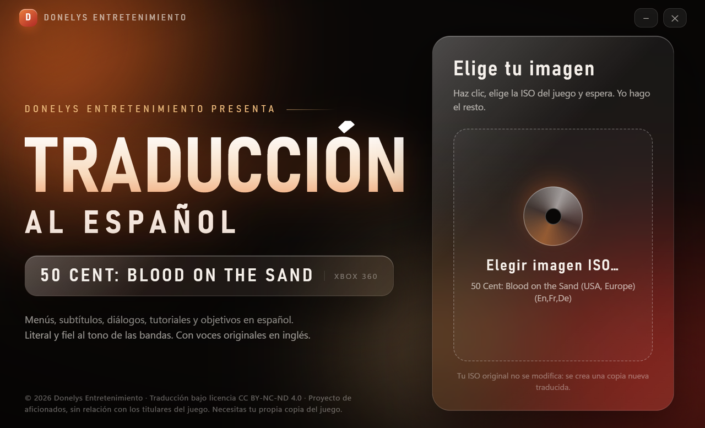
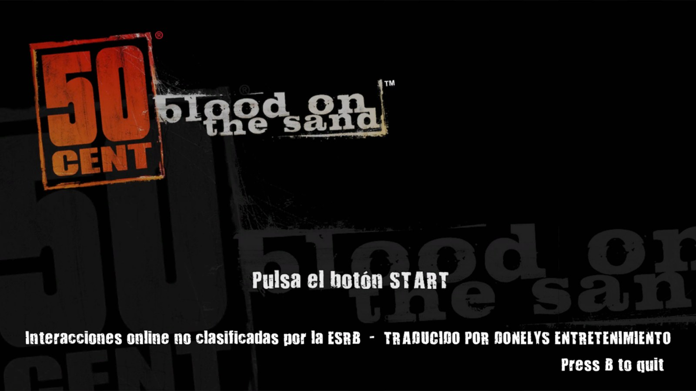
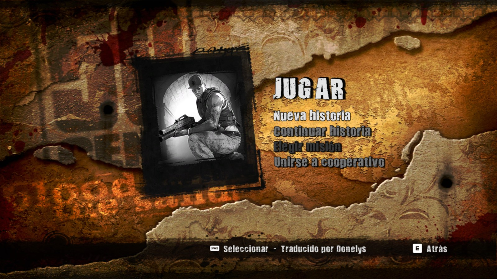
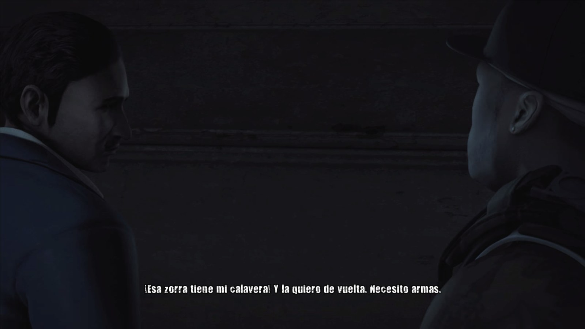
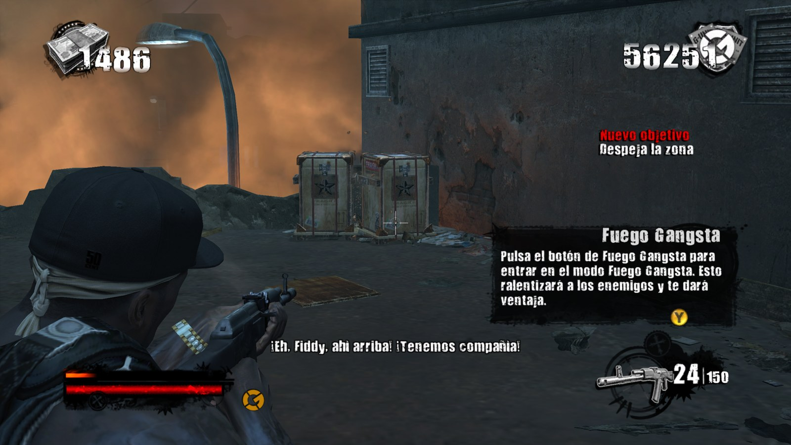
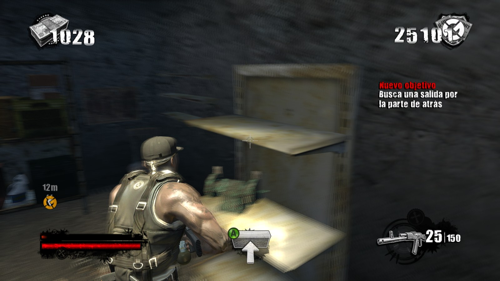
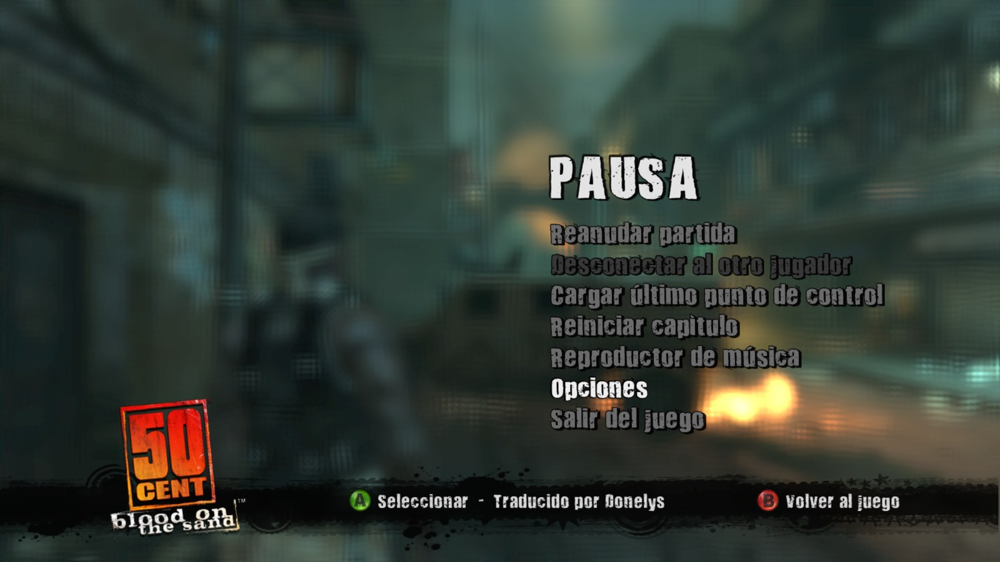
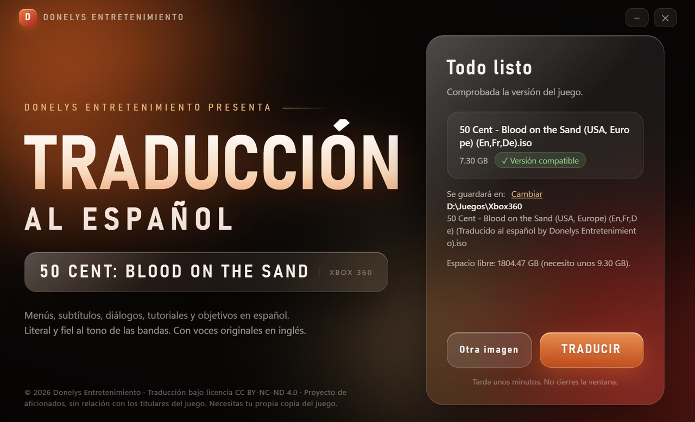
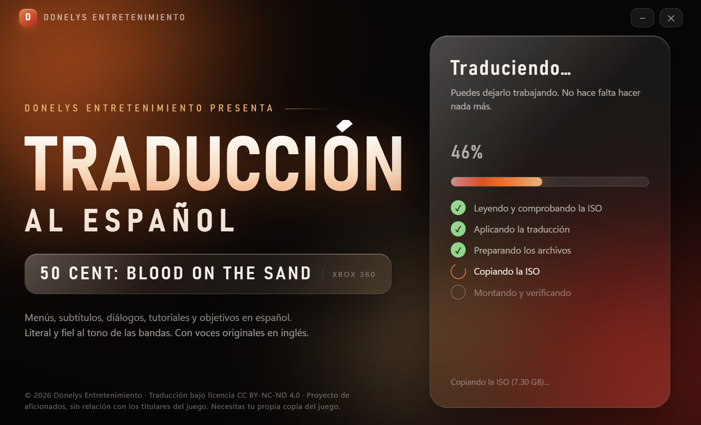
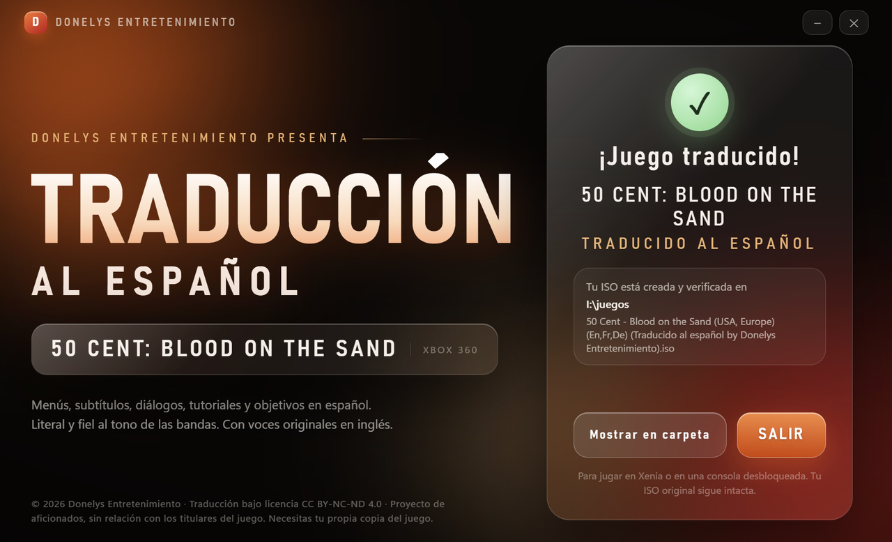

# 50 Cent: Blood on the Sand — Traducción al español

**Donelys Entretenimiento presenta** la traducción al español de *50 Cent: Blood on the Sand* (Xbox 360), con las voces originales en inglés y sin censura: literal y fiel al tono de las bandas.

🇬🇧 [English version below](#english)



## Qué traduce

| Parte | Contenido |
|---|---|
| Menús, opciones, HUD, logros, trucos, armas, misiones | 1 664 líneas de `Coalesced.INT` |
| Subtítulos de cinemáticas y réplicas de los personajes | 3 042 líneas |
| Consejos de las pantallas de carga | 53 |
| Tutoriales, objetivos de misión, marcadores y avisos de conducción | 373 textos en 38 paquetes `.xxx` |

## Qué está traducido y qué no

**✅ Traducido**

- Menús, opciones, HUD, logros, trucos, armas, misiones, capítulos y contraataques letales.
- Subtítulos de cinemáticas y diálogos de los personajes (50 Cent, Banks, Whoo Kid, Yayo, Anwar, Leila, Kamal, Carter, Merc, Wilder, Pilot, Eddy).
- Los 53 consejos de las pantallas de carga (el resto de huecos del juego están vacíos).
- Tutoriales, objetivos, marcadores y avisos de conducción (373 textos en 38 paquetes).
- Pantalla de título («Pulsa el botón START»), barra de botones y nombres de listas de cooperativo y clasificación.

**❌ No traducido**

- **Voces y música**: siguen en inglés original (solo se traduce texto, por diseño).
- **Texto dentro de texturas y vídeos**: logos, rótulos de vídeo, los vídeos de créditos y cinemáticas con texto grabado, y algún rótulo suelto como «Press B to quit» en la pantalla de título.
- **Desafíos de escenario**: los nombres y descripciones de algunos desafíos (p. ej. «Steely Gare — Kill 3x Assault Enemies») salen en inglés; viven en paquetes de nivel que todavía no se han traducido.
- **Mensajes internos del motor** (`Engine`, `Core`, `Startup`, `Launch`…): errores de red, de carga y de depuración, que el jugador casi nunca ve. `Descriptions.int` (etiquetas de editor) tampoco se toca.
- **Idiomas francés y alemán**: `Coalesced.FRA` y `Coalesced.DEU` quedan intactos. La traducción sustituye al texto en inglés (`Coalesced.INT`), así que **tu consola o emulador debe estar en inglés** para verla.

**⚠️ Comprobado y por comprobar**

- Verificado en partida: arranque, menús, «Jugar», pausa, subtítulos de la cinemática inicial, tutoriales y pantalla de objetivos del primer nivel.
- El resto de niveles está traducido por datos, pero no los he revisado uno a uno: puede haber textos que no caben en alguna caja o que se parten de forma fea (por ejemplo, justo después de «¡»). Si encuentras uno, abre una *issue* con una captura.

## Capturas

| | |
|---|---|
|  |  |
|  |  |
|  |  |

## Cómo usarlo (lo fácil)

1. Descarga **`Setup_Traduccion_ES_Donelys.exe`** desde [Releases](../../releases/latest).
2. Ábrelo, pulsa **Elegir imagen ISO…** y elige tu ISO de *50 Cent: Blood on the Sand (USA, Europe) (En,Fr,De)*.
3. Pulsa **TRADUCIR** y espera unos minutos. Se crea una **ISO nueva** traducida; la tuya no se modifica.
4. Juega con ella en [Xenia](https://github.com/xenia-canary/xenia-canary) (abre la ISO nueva) o en una consola desbloqueada.

| Elegir ISO | Comprobada | Traduciendo | Listo |
|---|---|---|---|
|  |  |  |  |

**No necesitas instalar Python ni nada más**: el `.exe` lo incluye todo. Requisitos: Windows 10/11 con *Microsoft Edge WebView2* (viene con Windows 11 y con Windows 10 actualizado), unos 10 GB libres y tu propia copia del juego.

### Versión de PC (recompilado) o carpeta extraída

Si juegas con el port de PC recompilado ([Skullburglar](https://github.com/nlwstein/skullburglar)) o tienes los archivos del juego extraídos, usa el parcheador de `src/` (necesita Python 3.10+):

```bash
python -m pip install --user pycryptodome lzallright
python src/aplicar_traduccion.py apply --game "RUTA\\a\\la\\carpeta\\del\\juego"      # aplica
python src/aplicar_traduccion.py status --game "RUTA\\..."                            # ORIGINAL / TRADUCIDO
python src/aplicar_traduccion.py restore --game "RUTA\\..."                           # vuelve a los originales exactos
```

Hace copias verificadas por SHA-1 antes de tocar nada y se puede revertir. También hay `.bat` de ayuda en `src/`.

### Desde la consola (ISO)

```bash
python src/parcheador_iso.py "mi_juego.iso" "mi_juego_traducido.iso"
```

## Qué hace por dentro

- Lee tu ISO (formato XDVDFS), extrae **solo** los 40 archivos que cambia la traducción (`default.xex`, `Coalesced.INT` y 38 paquetes), comprueba por **SHA-1** que son los de la versión compatible y aplica la traducción.
- El juego valida el SHA-1 de `Coalesced.INT` contra una tabla dentro de `default.xex`; el parche la actualiza para evitar el *Disc Read Error*.
- Los paquetes de Unreal Engine 3 se reescriben recalculando los tamaños internos y se verifican antes de usarse.
- La ISO nueva es una copia de la tuya con esos archivos sustituidos (en su sitio o al final de la imagen); el resto queda byte a byte igual. Se relee y se verifica antes de darla por buena.
- **No se distribuye ningún archivo del juego**: todo se reconstruye en tu equipo a partir de tu copia.

Versión compatible: `default.xex` SHA-1 `de2569aabc937f9c6528753e2f46d624f7ff7276`, `Coalesced.INT` SHA-1 `323e79463207fb810f651688541f88ee9243b82f`.

## Probado en

| | |
|---|---|
| CPU | AMD Ryzen 7 9800X3D (8 núcleos / 16 hilos) |
| GPU | NVIDIA GeForce RTX 5090 |
| RAM | 64 GB (62 GB utilizables) |
| Almacenamiento | SSD |
| Sistema | Windows 11 Pro (build 10.0.26300) |
| Emulador | Xenia Canary `canary_experimental@72c2afa3b` (26-oct-2026), Direct3D 12 |
| Versión de PC | port recompilado Skullburglar (ReXGlue) |
| Interfaz del setup | Microsoft Edge WebView2 155 |

Verificado: el juego arranca, los menús, «Jugar», la pausa, subtítulos, tutoriales y objetivos salen en español y la ISO nueva se ejecuta en Xenia. Los fallos gráficos que puedan verse en Xenia son del emulador, no de la traducción. **No probado en consola real**: una consola retail no acepta el `default.xex` modificado (hace falta RGH/JTAG u otro método de ejecución de código sin firmar).

## Licencia

- **Traducción** (`src/traducciones_es.json`, `src/traducciones_paquetes.json`, textos de la interfaz): [CC BY-NC-ND 4.0](https://creativecommons.org/licenses/by-nc-nd/4.0/deed.es). Puedes copiarla y compartirla sin cambios, citando a *Donelys Entretenimiento*, sin fines comerciales y sin quitar los créditos. No se puede vender ni redistribuir modificada.
- **Código**: [MIT](LICENSE-CODE-MIT.txt). Reutilizable, pero eso no incluye los textos de la traducción.
- **Terceros**: [THIRD_PARTY_NOTICES.md](THIRD_PARTY_NOTICES.md). Las herramientas de formato de paquetes se basan en [nlwstein/skullburglar](https://github.com/nlwstein/skullburglar) (BSD-3).
- Texto completo y detalle: [LICENSE](LICENSE).

## Aviso legal

Proyecto de aficionados, sin relación con 50 Cent, Swordfish Studios, Sierra, Activision ni ningún otro titular de derechos del juego. *50 Cent: Blood on the Sand* y todo su contenido original pertenecen a sus propietarios. Este repositorio **no incluye el juego, ni ISOs, ni archivos del juego**, y no da enlaces para conseguirlos: necesitas tu propia copia. El juego es solo para adultos (+18).

## Compilar el setup desde el código

```bash
python -m pip install pyinstaller pywebview pycryptodome lzallright pillow
python build_setup.py          # genera dist/Setup_Traduccion_ES_Donelys.exe
```

---

<a name="english"></a>
# 50 Cent: Blood on the Sand — Spanish translation

**Donelys Entretenimiento presents** the Spanish translation of *50 Cent: Blood on the Sand* (Xbox 360): original English voices, uncensored, literal and faithful to the street-gang tone.

## What is translated

| Part | Content |
|---|---|
| Menus, options, HUD, achievements, cheats, weapons, missions | 1,664 lines of `Coalesced.INT` |
| Cutscene subtitles and character lines | 3,042 lines |
| Loading screen tips | 53 |
| Tutorials, mission objectives, waypoint labels, driving messages | 373 texts in 38 `.xxx` packages |

## What is translated and what is not

**✅ Translated**

- Menus, options, HUD, achievements, cheats, weapons, missions, chapters and counter-kill moves.
- Cutscene subtitles and character dialogue (50 Cent, Banks, Whoo Kid, Yayo, Anwar, Leila, Kamal, Carter, Merc, Wilder, Pilot, Eddy).
- All 53 real loading-screen tips (the other slots in the game are empty).
- Tutorials, objectives, waypoint labels and driving messages (373 texts in 38 packages).
- Title screen ("Pulsa el botón START"), button bar, co-op and leaderboard list names.

**❌ Not translated**

- **Voices and music**: original English (text only, by design).
- **Text inside textures and videos**: logos, video captions, the credits video and cutscenes with burned-in text, and a few loose labels such as "Press B to quit" on the title screen.
- **Scenario challenges**: names and descriptions of some challenges (e.g. "Steely Gare — Kill 3x Assault Enemies") still show in English; they live in level packages not translated yet.
- **Internal engine messages** (`Engine`, `Core`, `Startup`, `Launch`…): network, loading and debug errors that players rarely see. `Descriptions.int` (editor labels) is left alone too.
- **French and German**: `Coalesced.FRA` and `Coalesced.DEU` are untouched. The translation replaces the English text (`Coalesced.INT`), so **your console or emulator must be set to English** to see it.

**⚠️ Verified vs. still to check**

- Verified in-game: boot, menus, "Jugar", pause, opening-cutscene subtitles, tutorials and the objectives screen of the first level.
- The remaining levels are translated in the data but I have not reviewed each one: some text may not fit a box or may wrap awkwardly (e.g. right after "¡"). If you find one, open an *issue* with a screenshot.

## Screenshots

See the [screenshots above](#capturas). Setup: choose ISO → verified → translating → done.

## How to use (the easy way)

1. Download **`Setup_Traduccion_ES_Donelys.exe`** from [Releases](../../releases/latest).
2. Open it, click **Elegir imagen ISO…** and pick your *50 Cent: Blood on the Sand (USA, Europe) (En,Fr,De)* ISO.
3. Click **TRADUCIR** and wait a few minutes. A **new translated ISO** is created; yours is not modified.
4. Play it in [Xenia](https://github.com/xenia-canary/xenia-canary) (open the new ISO) or on a modded console.

**No Python or extra installs needed**: the `.exe` bundles everything. Requirements: Windows 10/11 with *Microsoft Edge WebView2* (included in Windows 11 and up-to-date Windows 10), about 10 GB free, and your own copy of the game.

### PC (recompiled) version or extracted game folder

For the recompiled PC port ([Skullburglar](https://github.com/nlwstein/skullburglar)) or extracted game files, use the patcher in `src/` (needs Python 3.10+):

```bash
python -m pip install --user pycryptodome lzallright
python src/aplicar_traduccion.py apply --game "PATH\\to\\game\\folder"
python src/aplicar_traduccion.py status --game "PATH\\..."     # ORIGINAL / TRADUCIDO
python src/aplicar_traduccion.py restore --game "PATH\\..."    # back to the exact originals
```

It makes SHA-1-verified backups before touching anything and is fully reversible.

### From the console (ISO)

```bash
python src/parcheador_iso.py "my_game.iso" "my_game_translated.iso"
```

## How it works

- Reads your ISO (XDVDFS), extracts **only** the 40 files the translation changes (`default.xex`, `Coalesced.INT` and 38 packages), verifies by **SHA-1** that they match the supported version, and applies the translation.
- The game checks the SHA-1 of `Coalesced.INT` against a table inside `default.xex`; the patch updates it to avoid the *Disc Read Error*.
- The new ISO is a copy of yours with those files replaced (in place or at the end of the image); everything else stays byte-identical. It is re-read and verified before it is accepted.
- **No game files are distributed**: everything is rebuilt on your machine from your own copy.

## Tested on

AMD Ryzen 7 9800X3D (8C/16T) · NVIDIA GeForce RTX 5090 · 64 GB RAM · SSD · Windows 11 Pro (build 10.0.26300) · Xenia Canary `canary_experimental@72c2afa3b` (Oct 26, 2026), Direct3D 12 · recompiled Skullburglar PC port (ReXGlue) · WebView2 155.

Verified: the game boots, menus, "Jugar", pause, subtitles, tutorials and objectives appear in Spanish, and the new ISO runs in Xenia. Graphical glitches you may see in Xenia come from the emulator, not the translation. **Not tested on a real console**: a retail console will not accept the modified `default.xex` (RGH/JTAG or another unsigned-code method is required).

## License

- **Translation** (`src/traducciones_es.json`, `src/traducciones_paquetes.json`, UI texts): [CC BY-NC-ND 4.0](https://creativecommons.org/licenses/by-nc-nd/4.0/). You may copy and share it unchanged, crediting *Donelys Entretenimiento*, non-commercially, without removing the credits. It may not be sold or redistributed modified.
- **Code**: [MIT](LICENSE-CODE-MIT.txt). Reusable, but this does not include the translation texts.
- **Third parties**: [THIRD_PARTY_NOTICES.md](THIRD_PARTY_NOTICES.md). The package-format tooling is based on [nlwstein/skullburglar](https://github.com/nlwstein/skullburglar) (BSD-3).
- Full text and details: [LICENSE](LICENSE).

## Legal notice

Fan project, unaffiliated with 50 Cent, Swordfish Studios, Sierra, Activision or any other rights holder. *50 Cent: Blood on the Sand* and all its original content belong to their owners. This repository **does not include the game, ISOs or game files**, and gives no links to obtain them: you need your own copy. The game is for adults only (18+).

## Build the setup from source

```bash
python -m pip install pyinstaller pywebview pycryptodome lzallright pillow
python build_setup.py          # produces dist/Setup_Traduccion_ES_Donelys.exe
```
